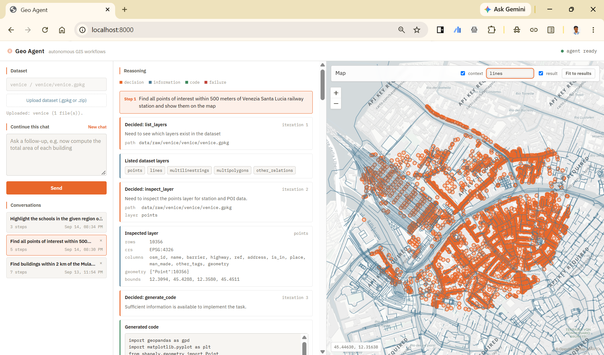
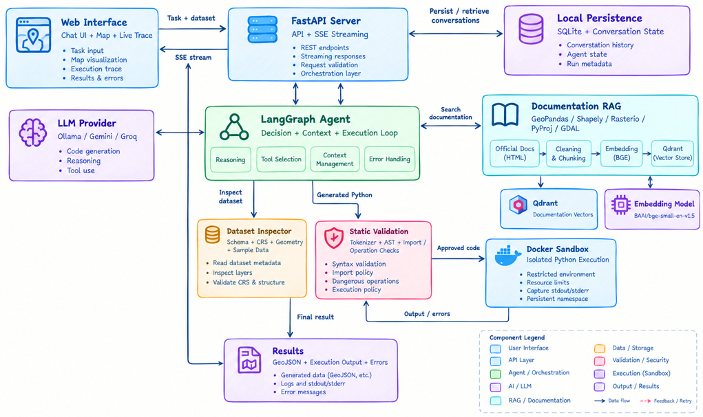
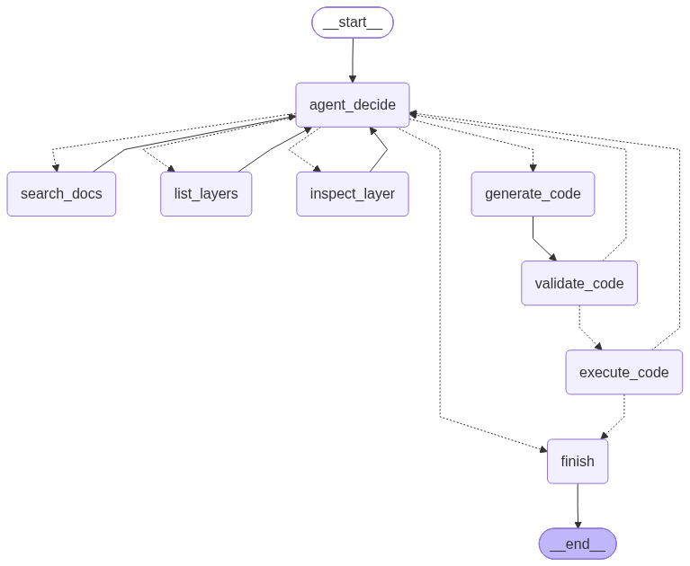
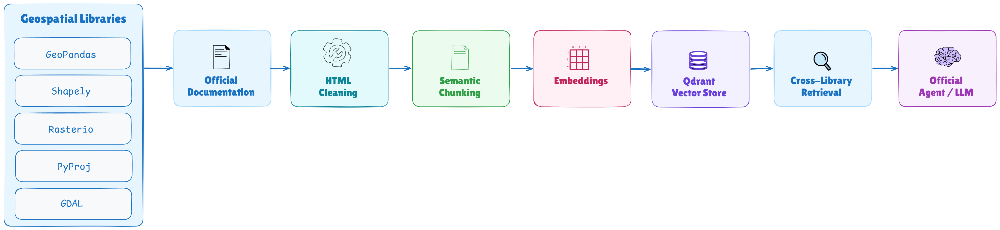
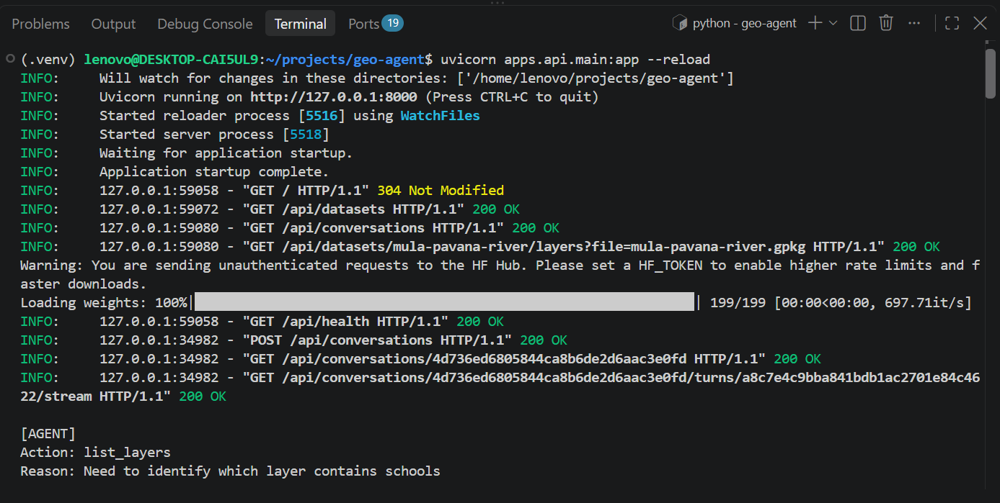
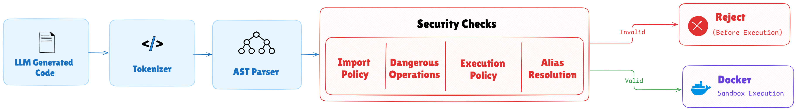
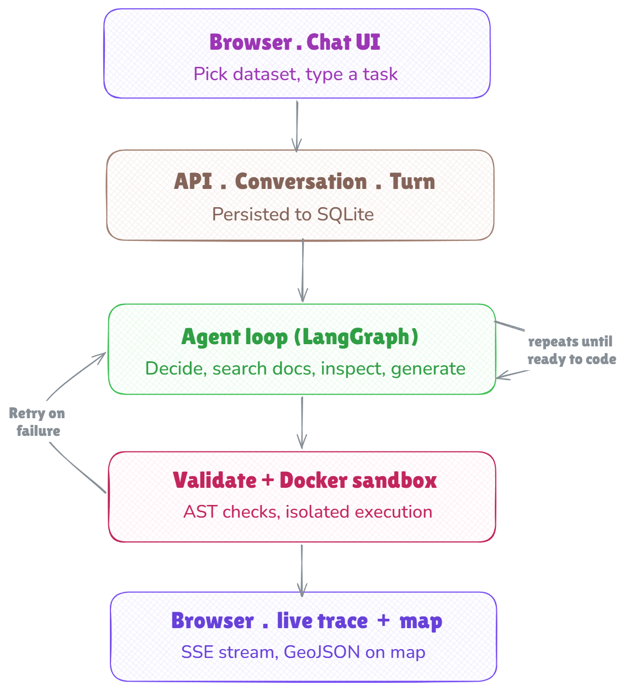

# GeoSpatial CodeAgent

A geospatial code agent that uses documentation retrieval and dataset inspection to generate and execute Python geospatial workflows inside an isolated Docker sandbox.

Instead of exposing GIS operations as a fixed collection of predefined tools, GeoSpatial CodeAgent allows the LLM to compose geospatial workflows dynamically using Python libraries such as GeoPandas and Shapely. Generated code is statically validated before execution, and execution failures are returned to the agent for diagnosis and retry.


*GeoSpatial CodeAgent web interface showing the reasoning trace, conversation history, task execution, and resulting map.*

## Overview

GeoSpatial CodeAgent is designed around a simple idea:

> Let the agent write geospatial code, but strictly control what code is allowed to execute.

Given a natural-language geospatial task, the agent can:

1. Determine what information it needs.
2. Retrieve relevant geospatial documentation.
3. Inspect the available dataset and its layers.
4. Generate Python geospatial code.
5. Validate the generated code using AST and security checks.
6. Execute the validated code inside an isolated Docker sandbox.
7. Inspect execution results or errors.
8. Retry or finish based on the result.

The system is orchestrated as a stateful LangGraph workflow, exposed over a FastAPI backend and a browser UI so the reasoning trace, generated code, and resulting map are visible while a task runs (see [Web Interface](#web-interface)).


## Architecture



## Why Code Generation?

A conventional tool-calling GIS agent could expose operations such as:

* buffer
* intersection
* reprojection
* spatial join
* dissolve

and require the model to select and parameterize those operations.

GeoSpatial CodeAgent takes a different approach.

The agent generates Python code using the available geospatial programming libraries. This allows a single workflow to combine multiple operations and construct task-specific logic without requiring every possible GIS operation to be manually registered as an agent tool.

The trade-off is that generated code must be treated as untrusted input. This is why code validation and sandboxed execution are core parts of the architecture rather than optional additions.

## Core Components

### 1. LangGraph Agent



LangGraph manages the agent's state and execution flow.

The decision node determines whether the agent should:

* search documentation
* inspect dataset layers
* inspect a specific layer
* generate code
* finish

The workflow can return to the decision node after information gathering or execution failures.

### 2. Documentation RAG

The agent uses a local documentation retrieval system to provide library-specific information during reasoning. It searches across every library that's been indexed and merges results by relevance, rather than being pinned to one library - so a task that needs both GeoPandas and Shapely documentation gets both, without the agent needing to know in advance which library's docs to consult.

The pipeline is scoped to five geospatial libraries (`docs/manifest.yaml`, `packages/rag/config.py`):

* GeoPandas v1.1.4 - indexed (~812 chunks)
* Shapely v2.1.2 - pipeline ready, not yet indexed
* Rasterio v1.5.1 - pipeline ready, not yet indexed
* PyProj v3.7.2 - pipeline ready, not yet indexed
* GDAL v3.8.4 - pipeline ready, not yet indexed

"Pipeline ready" means `download_docs.py`, a theme-matched HTML cleaner, `chunk_docs.py`, and `embed_docs.py` all work for that library today - running the four commands below for a library adds it to retrieval immediately, no code changes required:

```bash
python packages/rag/download_docs.py shapely
python packages/rag/clean_docs.py shapely
python packages/rag/chunk_docs.py shapely
python packages/rag/embed_docs.py shapely
```

Each library gets its own Qdrant collection (`<library>_docs`), populated via:




The HTML cleaners share one engine (`packages/rag/cleaners/_sphinx_common.py`) that handles Sphinx's own autodoc output (API signatures, parameter lists, code blocks) - this part is identical across every Sphinx-based site regardless of theme. Only the top-level content-container selector varies by theme, which is why each library has a thin wrapper module (`packages/rag/cleaners/<library>.py`) declaring just that: GeoPandas and PyProj/Shapely differ (PyData Sphinx theme vs. Furo), Rasterio uses the classic Read the Docs theme. The GDAL cleaner's selector list is broader and explicitly flagged as unverified in its docstring, since gdal.org's exact theme couldn't be confirmed against real HTML during development - `clean_docs.py` reports an "EMPTY" page count on every run specifically so a wrong selector shows up immediately instead of silently producing a thin corpus.

Embeddings use:

```text
BAAI/bge-small-en-v1.5
```

### 3. Dataset Inspection

Before generating code, the agent can inspect the structure of the supplied geospatial dataset.

For example, the Mula–Pavana GeoPackage contains layers including:

```text
points
lines
multilinestrings
multipolygons
other_relations
```

The agent can inspect layer metadata and use the observations to determine which layer and attributes are relevant to the requested task.

### 4. Python Code Generation

Once sufficient information is available, the LLM generates a Python geospatial workflow.

The generated program can use the approved geospatial environment rather than being restricted to a small set of predefined GIS operations.

This is the central distinction between the project and a conventional fixed-tool GIS agent.

### 5. Static Code Validation

Generated code is not executed immediately.

It passes through multiple validation stages, including:

* tokenization checks
* AST parsing
* import-policy validation
* dangerous-operation detection
* execution-policy checks

Invalid code is rejected before reaching the execution environment.

### 6. Docker Sandbox

Validated code executes inside a dedicated Docker sandbox.

The sandbox provides isolation between generated code and the host environment while allowing the agent to produce files and other artifacts required by the workflow.

Execution results include:

* status
* stdout
* stderr
* generated artifacts
* execution errors

### 7. Error Feedback

Execution failures are returned to the agent.

The agent can use the error information to diagnose the problem, retrieve additional documentation or inspect the dataset again, regenerate the code, and retry.

The current graph limits the overall workflow iterations to prevent unbounded execution.

## Example Workflow
```prompt
One demonstrated workflow asks the agent to identify buildings within 500 meters of the Mula River. 
```
or 

```prompt
Find all points of interest within 500 meters of Venezia Santa Lucia railway station and show them on the map.
```
The agent:

1. Listed the available GeoPackage layers.
2. Inspected relevant layers.
3. Generated a Python geospatial workflow.
4. Generated code initially failed static validation.
5. The agent regenerated the workflow.
6. The regenerated code passed validation.
7. The code executed successfully inside the Docker sandbox.
8. A GeoPackage containing 6,533 building geometries was produced.

The resulting output was independently validated.

```text
Feature count       : 6,533
CRS                 : EPSG:32643
Geometry types      : MultiPolygon
Invalid geometries  : 0
Empty geometries    : 0
Null geometries     : 0
Buildings outside   : 0
```

An independent spatial validation reproduced the 500 m Mula River buffer and confirmed that all 6,533 agent-produced geometries were inside the independently computed buffer.

The result therefore validates the internal correctness of the demonstrated agent workflow. It should not be interpreted as a claim that 6,533 represents every building in the broader Mula–Pavana study area, since the demonstrated agent workflow and the broader reference workflow use different river scopes.

And for Venice - Number of points of interest within 500 m of Venezia Santa Lucia railway station: 3818

## Web Interface

The agent is also exposed through a small full-stack layer so a task can be run and watched from a browser instead of a terminal  and, since GIS workflows are rarely one-shot, as a persistent chat you can leave and come back to.

```text
apps/
├── api/     # FastAPI backend
└── ui/      # Plain HTML/CSS/JS frontend (no build step)
```

**Backend (`apps/api`)** wraps the existing LangGraph agent  it does not reimplement any agent logic. A submitted task runs on a dedicated worker thread via `graph.stream(state, stream_mode="updates")`, and each node's output is translated into a small JSON event, persisted to SQLite, and pushed to the browser over Server-Sent Events. This means the reasoning trace in the UI is a direct view of the same graph in `packages/agent/graph.py`, not a simulation of it.



**Conversations** (`apps/api/storage.py`) are the persistence unit  a chat thread scoped to one dataset, made up of one or more *turns* (each turn is one task run through the agent graph). They're stored in a local SQLite database (`data/geo_agent.db`, gitignored - it's runtime data, not something to commit) so past chats survive a server restart and show up in the sidebar.

Continuing a conversation isn't just a UI convenience - the next turn is seeded with the previous turn's discovered layer schemas and retrieved documentation (so the agent doesn't redo `list_layers`/`inspect_layer`/`search_docs` it already has answers for), and a short summary of prior turns' tasks and outcomes is prepended to the new task text, so "now also compute their area" resolves against "their" correctly. Both mechanics live entirely in the API layer (`_build_composite_task` and the `create_turn` context seeding in `storage.py`) - the agent graph itself is unmodified.

Endpoints:

| Endpoint                                          | Purpose                                                             |
| -------------------------------------------------- | -------------------------------------------------------------------- |
| `GET /api/health`                                  | Reports whether the LLM provider and RAG retriever initialized      |
| `GET /api/datasets`                                | Lists dataset folders under `data/raw/` and their vector files      |
| `POST /api/datasets`                               | Uploads a dataset  a single vector file or a `.zip` extract (e.g. a BBBike download)  generalizable to any GIS extract, not just the one used during development |
| `GET /api/datasets/{name}/layers`                  | Lists layers inside one file of a dataset                           |
| `POST /api/conversations`                          | Starts a new chat: creates a conversation and its first turn        |
| `GET /api/conversations`                           | Lists past and in-progress chats, most recently updated first       |
| `GET /api/conversations/{id}`                      | Full chat detail  every turn, with its reasoning trace and results |
| `DELETE /api/conversations/{id}`                   | Deletes a chat                                                       |
| `POST /api/conversations/{id}/turns`               | Continues a chat with a follow-up task                              |
| `GET /api/conversations/{id}/turns/{turn}/stream`  | Server-Sent Events stream of a turn's live reasoning trace          |
| `GET /api/geo`                                     | Converts a raw dataset layer or an output artifact to GeoJSON (reprojected to EPSG:4326) for the map |

The agent's LLM provider and RAG retriever (an embedding model and a local Qdrant client) are held as long-lived singletons rather than reloaded per request, so the API serializes turn execution through a single worker thread instead of running multiple agent runs concurrently. Submitting and polling stays non-blocking either way. The worker thread is started and stopped as part of the app's lifespan rather than at import time, so it can be cleanly restarted in-process (this matters for tests spinning up multiple app instances in one pytest session, and is generally the more correct pattern).

**Frontend (`apps/ui`)** is a single-page console with three panes:

* **Run**  pick or upload a dataset, write a task in plain language, and run it. Once a chat exists, this becomes "continue this chat" (dataset locked, task label changes to "Send") until you click "New chat".
* **Reasoning**  a live timeline of the agent's decisions, documentation searches, layer inspections, generated code, validation results, and execution output as they happen, grouped under a header for each turn so a multi-step conversation reads like a chat transcript rather than one undifferentiated log.
* **Conversations**  the sidebar list of past chats (title, step count, last-updated time); click one to reopen its full history, or the × to delete it.
* **Map**  the resulting artifact rendered on a Leaflet map (pan/zoom like a normal map), with an optional context layer from the input dataset for reference.

To run it locally:

```bash
uvicorn apps.api.main:app --reload
```

Then open `http://localhost:8000`. The Docker sandbox and your configured LLM provider (see [Setup](#setup)) still need to be available for a submitted task to actually execute  `GET /api/health` reports whether the agent initialized correctly if something is misconfigured.

## Security Model

Generated Python code is treated as untrusted.

The execution pipeline therefore follows:



This provides multiple layers of protection before generated code is executed.

Import and call-site checks resolve aliasing before matching  `import os as x; x.system(...)` or `from os import system; system(...)` are caught the same as `os.system(...)` directly, rather than only matching the literal source text. Static analysis like this is necessarily incomplete (fully dynamic dispatch, e.g. `getattr(os, "system")(...)`, can't be caught by AST inspection alone), which is why it's treated as one layer among several rather than the sole safety guarantee: the Docker sandbox itself runs with `--network none`, a non-root user, and read-only input mounts, so a validator bypass is contained rather than catastrophic.

## Technology Stack

| Component                 | Technology                            |
| ------------------------- | ------------------------------------- |
| Agent orchestration       | LangGraph                             |
| LLM providers             | Gemini / Ollama / Groq                |
| Current development model | Qwen3.6-27B                           |
| Programming language      | Python                                |
| Geospatial processing     | GeoPandas, Shapely, PyProj, Rasterio  |
| Documentation RAG         | Qdrant                                |
| Embeddings                | BAAI/bge-small-en-v1.5                |
| Code validation           | Python AST + custom security policies |
| Execution isolation       | Docker                                |
| Dataset format            | GeoPackage                            |
| Web backend               | FastAPI, Server-Sent Events           |
| Persistence               | SQLite (conversations/turns)          |
| Web frontend              | Plain HTML/CSS/JS, Leaflet            |
| Testing                   | pytest                                |

## Project Structure

```text
GeoSpatial CodeAgent/
├── apps/
│   ├── api/            # FastAPI backend (wraps the agent graph)
│   └── ui/             # Plain HTML/CSS/JS frontend, served by the API
│
├── packages/
│   ├── agent/          # LangGraph workflow and agent nodes
│   ├── execution/      # Validation and Docker sandbox
│   ├── rag/            # Documentation retrieval pipeline
│   ├── tools/          # Agent information-gathering tools
│   └── geo_tools/      # Geospatial utilities (used by the independent
│                        # validation scripts under scripts/, not by the
│                        # agent itself  see "Why Code Generation?")
│
├── scripts/             # Reproducible project workflows
├── docs/                # Documentation configuration
├── tests/               # pytest suite
│
├── data/                # Local datasets and generated outputs
├── rag/                 # Generated RAG artifacts
│
├── requirements.txt
├── requirements-dev.txt
├── .env.example
├── activate.sh
└── README.md
```

The `data/` and root `rag/` directories contain local/generated artifacts and are intentionally excluded from version control.

## Setup

Clone the repository and create the Python environment:

```bash
python -m venv .venv
source .venv/bin/activate
```

Install dependencies:

```bash
pip install -r requirements.txt
```

For running the test suite as well:

```bash
pip install -r requirements-dev.txt
```

Configure environment variables using:

```text
.env.example
```

Copy it to `.env` and fill in what your chosen LLM provider needs  it's loaded automatically (via `python-dotenv`) the first time the agent is used, so no manual `export` is required.

The project also includes:

```bash
./activate.sh
```

for the project's environment setup.

### RAG Setup

The documentation pipeline can be used to download, clean, chunk, embed, and index the supported documentation corpus.

The generated RAG data is intentionally kept outside version control.

### Docker

The code execution environment is built from:

```text
packages/execution/Dockerfile.sandbox
```

The Docker sandbox must be available for workflows that execute generated geospatial code.

### Running on WSL2 + Docker Desktop + Ollama on Windows

This project was developed with the agent running inside WSL2 (Ubuntu), Docker Desktop for Windows providing the Docker daemon, and Ollama running natively on Windows (not inside WSL) for local models. If you're reproducing that setup:

* Docker Desktop's "WSL2 based engine" setting needs to be on, with integration enabled for your distro, so `docker` inside WSL talks to the same daemon.
* Ollama on Windows listens on the Windows host, which is a different network namespace from WSL2. `OllamaProvider` auto-detects the Windows host IP at runtime (via the WSL2 default gateway) instead of hardcoding it, since that IP is reassigned on every Windows reboot  see `packages/agent/llm/ollama_provider.py` if you need to override it manually via `OLLAMA_HOST` in `.env`.
* If Ollama is set to WSL2 "mirrored" networking mode instead of the default NAT mode, the Windows host is already reachable at `localhost`, which is what the provider falls back to if gateway detection doesn't apply.

## Testing

```bash
pytest
```

The suite (79 tests) covers the parts of the system that don't require Docker or a live LLM: the AST-based import/dangerous-operation policies (including alias-bypass regression tests), the combined code validator, artifact diffing, dataset/layer inspection against real small GeoPackages, the `Executor` orchestration logic (via a fake sandbox), the multi-library documentation cleaners and cross-library retrieval merge logic (via realistic per-theme HTML fixtures and a fake Qdrant client), the SQLite conversation/turn storage layer, and the FastAPI layer end-to-end - including the full create-chat → stream → continue-chat flow via a fake agent graph, so the conversation/continuation logic is exercised without needing Docker or a real LLM. Running the agent graph itself end-to-end still requires Docker and a configured LLM provider, so that path is exercised manually (`packages/agent/test_graph.py`) rather than in CI-style tests.

## Current Scope

The current V1 focuses on demonstrating the complete agent loop:



The project is intentionally not presented as a fully autonomous general-purpose GIS system. Its purpose is to demonstrate a controlled architecture for LLM-driven geospatial code generation and execution.

## Limitations

Current limitations include:

* Documentation RAG's *pipeline* covers five libraries, but only GeoPandas is actually indexed today - Shapely/Rasterio/PyProj/GDAL need `download_docs.py`/`clean_docs.py`/`chunk_docs.py`/`embed_docs.py` run once each (see [Documentation RAG](#2-documentation-rag)). The GDAL cleaner's content selector in particular wasn't verified against real HTML and may need adjustment after a first run.
* Generated-code reliability depends on the underlying LLM.
* Some generated code may require regeneration after validation failure.
* The current system does not perform visual evaluation of generated maps.
* Dataset understanding is based on available metadata and inspection tools rather than a dedicated visual geospatial reasoning model.
* The current V1 focuses on a controlled execution workflow rather than unrestricted autonomous GIS operation.
* The API runs one turn at a time (see [Web Interface](#web-interface)) rather than executing multiple turns concurrently.
* The map view caps rendered features per layer to keep the browser responsive; very large layers are truncated rather than paginated.
* There's no authentication on the API/UI  it's built for local, single-user use, not multi-tenant deployment.
* Conversation continuation prepends prior turns' task/outcome summaries to the new task text (see [Web Interface](#web-interface)) - a very long-running chat will eventually push a lot of text into the prompt, since there's no summarization or truncation of older turns yet.

## Future Work

Potential V2 improvements include:

* actually indexing Shapely/Rasterio/PyProj/GDAL (the pipeline supports it; running it just takes time against each site)
* stronger generated-code validation and repair
* richer dataset profiling
* visual map rendering and result evaluation
* vision-language models for geospatial output verification
* broader benchmark tasks for evaluating agent reliability (`packages/benchmarks/evaluator.py` exists but isn't wired into an automated run yet)
* improved observability and execution tracing
* concurrent turn execution in the API, if the RAG retriever and LLM client are made safely shareable across threads
* paginated/tiled map rendering for layers larger than the current feature cap
* summarizing older turns in a long conversation instead of always carrying the full task/outcome history forward
